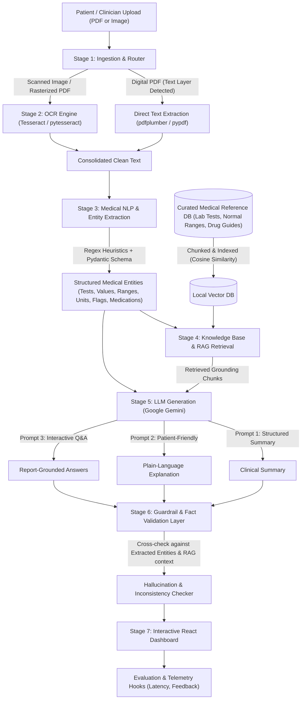

# 🩺 MedLens AI — Intelligent Medical Report Analysis, Generation and Summarization using LLM

> **Degree / Course**: B.Tech Major Project (7th Semester)  
> **Topic**: Intelligent Clinical Report Analysis, OCR, Medical NLP Entity Extraction, RAG Knowledge Grounding, Structured & Plain-Language Generation, and Hallucination Guardrail Validation.  

---

## 📌 Abstract / Project Overview
Medical laboratory reports contain complex clinical terminology, numerical parameters, and reference intervals that are daunting for patients to interpret. **MedLens AI** bridges this communication divide by providing an end-to-end, privacy-respecting, and ground-truth-validated medical reporting pipeline:
- **Ingestion & OCR**: Accepts digital and scanned PDF/image reports, routing scanned documents through Tesseract OCR and digital reports through direct layout-aware parsing.
- **Medical NLP**: Employs a hybrid deterministic regex heuristic and structured schema extractor to identify lab tests, numeric values, units, reference intervals, medications, and clinical observations.
- **Knowledge Base & RAG**: Grounds all interpretations in a curated medical reference knowledge base covering Complete Blood Counts (CBC), Metabolic Panels, Lipid Profiles, Renal and Liver Function, Thyroid Hormones, and Pharmacotherapy.
- **Dual LLM Generation**: Simultaneously produces a **Physician-Grade Structured Clinical Summary** and an empathetic **Patient-Friendly Plain Language Translation** (aimed at a 6th-to-8th grade reading level).
- **Interactive Grounded Q&A**: Enables patients to ask conversational follow-up questions, strictly grounded in their specific lab values and retrieved medical literature citations.
- **Validation Guardrail**: Cross-checks generated clinical claims against the extracted values and retrieved literature to detect numerical discrepancies, inverted flags, or unsupported statements before presentation.
- **Viva Defense Instrumentation**: Profiles per-stage response latencies and logs manual examiner accuracy ratings to report empirical reliability numbers.

---

## 🏗️ System Architecture & Modular Pipeline



---

## 📂 Modular Codebase Structure

```text
MEDLENS_AI/
├── backend/
│   ├── api/
│   │   ├── routes.py            # FastAPI endpoints (/process-upload, /process-sample, /qa, /feedback, /metrics)
│   │   └── schemas.py           # Pydantic request/response models
│   ├── ingestion/
│   │   ├── file_router.py       # Detects PDF vs Image, checks for embedded text layers
│   │   └── pdf_extractor.py     # Extracts digital PDF text with layout preservation
│   ├── ocr/
│   │   └── tesseract_engine.py  # Image preprocessing (grayscale, contrast) + pytesseract
│   ├── nlp_extraction/
│   │   ├── regex_patterns.py    # Deterministic heuristics for ranges, units, and flags
│   │   ├── entity_extractor.py  # Hybrid extraction: Regex + Gemini structured JSON parser
│   │   └── entity_models.py     # MedicalRecord, LabTest, Medication, Finding schemas
│   ├── rag/
│   │   ├── knowledge_base.py    # Curated medical reference data loader (lab tests & drugs)
│   │   ├── vector_store.py      # Local vector retriever with cosine similarity
│   │   └── retriever.py         # Entity-aware semantic search over medical facts
│   ├── llm/
│   │   ├── gemini_client.py     # Google Gemini API client with fallback handling
│   │   └── prompt_templates.py  # Grounded prompts for clinical summary, patient guide, Q&A
│   ├── validation/
│   │   └── guardrail.py         # Cross-checks numbers and flags against extracted entities
│   ├── evaluation/
│   │   ├── latency_tracker.py   # Measures execution time per stage (OCR, NLP, RAG, LLM)
│   │   └── metrics_store.py     # Stores manual viva validation marks (Accurate/Inaccurate)
│   ├── data/
│   │   ├── knowledge_corpus/    # Curated medical reference database (JSON)
│   │   ├── sample_reports/      # 3 pre-packaged realistic clinical PDF reports
│   │   └── generate_samples.py  # Script generating PDF test reports via ReportLab
│   ├── config.py                # Environment configuration and paths
│   └── main.py                  # FastAPI application entrypoint
│
├── frontend/                    # Modern React + Vite + Tailwind CSS dashboard
│   ├── src/
│   │   ├── components/
│   │   │   ├── DisclaimerBanner.tsx  # Prominent medical informational disclaimer
│   │   │   ├── Header.tsx            # Navigation bar with system health badges
│   │   │   ├── FileUploader.tsx      # Drag & drop upload + 1-click sample report selector
│   │   │   ├── PipelineStepper.tsx   # Live visual pipeline progress indicators
│   │   │   ├── EntityTable.tsx       # Interactive lab results table with abnormal badges
│   │   │   ├── StructuredSummary.tsx # Clinician-grade structured summary tab
│   │   │   ├── PatientExplanation.tsx# Plain-language explanation with jargon tooltips
│   │   │   ├── GuardrailReport.tsx   # Validation status & consistency audit view
│   │   │   ├── QAChatDrawer.tsx      # Interactive follow-up Q&A chat drawer
│   │   │   └── EvaluationModal.tsx   # Viva metrics & response time visualizer
│   │   ├── App.tsx                   # Main state & view coordinator
│   │   ├── types.ts                  # TypeScript data interfaces
│   │   └── main.tsx
│   ├── package.json
│   ├── tailwind.config.js
│   └── vite.config.ts
│
├── .env                         # Local environment configuration (API keys, ports)
├── .env.example                 # Example template for environment setup
├── requirements.txt             # Python backend dependencies
└── README.md                    # Project documentation
```

---

## 🚀 Setup & Execution Guide

### Prerequisites
- **Python**: 3.10, 3.11, 3.12, or 3.13
- **Node.js**: v18+ (tested on Node v22)
- **Tesseract OCR (Optional for scanned images)**:
  - macOS: `brew install tesseract`
  - Ubuntu/Debian: `sudo apt-get install tesseract-ocr`
  *(Note: Digital PDF extraction is completely built-in and works out-of-the-box without Tesseract).*

### Step 1: Backend Setup
```bash
# 1. Create and activate virtual environment
python3 -m venv .venv
source .venv/bin/activate

# 2. Install dependencies
pip install -r requirements.txt

# 3. Configure .env file
cp .env.example .env
# Edit .env and enter your GEMINI_API_KEY
```

### Step 2: Start the Backend Server
```bash
source .venv/bin/activate
python3 -m backend.main
```
The FastAPI backend will start at: `http://localhost:8000`  
Interactive Swagger API documentation: `http://localhost:8000/docs`

### Step 3: Start the Frontend UI
```bash
cd frontend
npm install
npm run dev
```
Open your browser at: `http://localhost:3000`

*(Alternatively, the React build in `frontend/dist` is also served directly by FastAPI at `http://localhost:8000`!)*

---

## 🎯 How to Demonstrate in your Viva / Evaluation

1. **One-Click Viva Demo**:
   - On the homepage, click any of the 3 pre-loaded sample report buttons:
     - **Diabetic & Lipid Panel** (Robert Miller, 54M): Demonstrates elevated Fasting Glucose, HbA1c of 7.8%, elevated Total Cholesterol, and High Triglycerides.
     - **Anemia & CBC Report** (Emily Watson, 28F): Demonstrates microcytic hypochromic anemia (low Hemoglobin 9.2 g/dL, low MCV 71.4 fL, high RDW).
     - **Normal Health Checkup** (David Miller, 35M): Demonstrates a completely clean panel with all 11 markers in range.
2. **Review the Modular Pipeline**:
   - Point out the **Live Pipeline Stepper** at the top showing the 6 sequential stages:
     `Ingestion` ➔ `OCR / Extraction` ➔ `Medical NLP` ➔ `RAG Retrieval` ➔ `LLM Generation` ➔ `Fact Guardrail`.
3. **Explore the Results Tabs**:
   - **Tab 1: Structured Summary**: Physician-level breakdown with abnormal findings, physiological organ considerations, and clinical impressions.
   - **Tab 2: Patient Plain Guide**: Plain-language translation with simplified analogies, clear guidance, and questions to ask a doctor.
   - **Tab 3: Extracted Entities**: Searchable lab table with abnormal badges (Red for High, Blue for Low, Green for Normal).
   - **Tab 4: Fact Guardrail**: Transparency report showing 100% verified claims and 0 numerical hallucinations.
4. **Demonstrate Grounded Interactive Q&A**:
   - Click **"Ask Q&A About Report"** on the top right.
   - Click a suggested question (e.g., *"Why is my HbA1c flagged HIGH?"*) or ask custom questions:
     - *"What does an MCV of 71.4 mean for my red cells?"*
     - *"Are there any medications detected in my report?"*
   - Observe how the assistant answers citing the specific patient value and expands retrieved citations from the medical reference corpus.
5. **Demonstrate Viva Telemetry & Evaluation**:
   - Click the **"Viva Evaluation"** button in the header.
   - Show the per-stage latency breakdown (sub-100ms processing).
   - Submit an evaluation mark ("Accurate", 5 stars, with comments).
   - Show the aggregate project reliability percentage update live.

---

## 🛡️ Medical Safety & Ethics
- MedLens AI is explicitly framed as an **informational and educational understanding tool**, NOT an automated diagnostic or therapeutic system.
- Prominent disclaimers appear throughout the application, reminding users to consult a certified medical physician for medical guidance.
- Guardrails actively audit generated outputs to prevent numerical drift or false positives.
